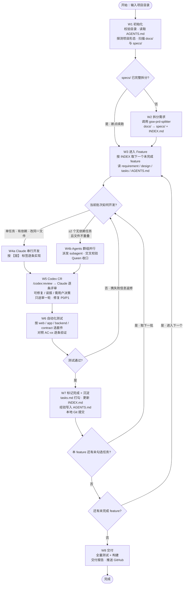

# /gsw-workflow — 从需求到交付 · 端到端开发工作流

工作流分三段：**准备 → 开发与验证 → 完成与交付**。
拆分、开发、CR、测试、提交，每步都是独立节点；节点规则不进本文件，按需读取。

## 📊 流程



## 🗂 节点文件

节点规则统一放在 `~/.claude/commands/gsw-workflow-nodes/`，**执行到哪个节点就读哪个文件**：

| 节点 | 文件 | 阶段 | 一句话 |
|------|------|------|--------|
| W1 | `W1-init.md` | 准备 | 校验目录，读 AGENTS.md，探测形态，判断 specs 是否已拆 |
| W2 | `W2-split.md` | 准备 | 调 splitter 拆成 specs/，产出 INDEX.md |
| W3 | `W3-enter-feature.md` | 开发与验证 | 取下一个 feature，判定本批次串行还是并行 |
| W4a | `W4a-develop.md` | 开发与验证 | Claude 串行开发 |
| W4b | `W4b-parallel-group.md` | 开发与验证 | Agents 群组并行 + 交叉校验 |
| W5 | `W5-codex-cr.md` | 开发与验证 | Codex 送审一轮 → Claude 评审 → 修复 |
| W6 | `W6-autotest.md` | 开发与验证 | 按形态跑测试 + AC 对账 |
| W7 | `W7-mark-and-learn.md` | 完成与交付 | 打勾 + 更新 INDEX + 写经验 + 本地 Git 提交 |
| W8 | `W8-deliver.md` | 完成与交付 | 全量验收 + 交付报告 + 推送远端 |

## 👥 角色分工

| 角色 | 谁 | 只在哪些节点出现 |
|------|-----|------------------|
| **Claude / Queen** | 主会话 | 全程：开发、编排、裁决、收口 |
| **Codex** | 插件 `codex@openai-codex`（`/codex:review`） | 仅 W5 做代码评审 |
| **Agents / subagent** | 派生 worker | 仅 W4b 并行开发与交叉校验 |

## 📥 项目输入约定

| 路径 | 作用 | 谁维护 |
|------|------|--------|
| `AGENTS.md` | 技术栈 + 历史经验，**唯一技术真相源** | W1 缺失时生成骨架；W7 追加经验 |
| `docs/` | 需求来源 | 人 |
| `specs/INDEX.md` | feature 索引与状态 | W2 生成；W3/W7 更新 |
| `specs/<feature>/requirement.md` | `R-xx` 需求 + `AC-xx` 验收标准 | W2 |
| `specs/<feature>/design.md` | 技术设计（技术栈取自 AGENTS.md） | W2 |
| `specs/<feature>/tasks.md` | `T-xx: [层] 描述（~工时）` | W2 生成；W7 打勾 |

## ⚙️ 执行约定

**节点规则（强制）**

1. **按节点顺序执行**，不跳节点。W2 仅在 specs 不完整时执行；W4b 仅在批次满足并行硬条件时启用。
2. **进入每个节点前，先读** `~/.claude/commands/gsw-workflow-nodes/` 下对应节点文件，按它执行。
3. **每个节点执行完，输出一行确认**：`✅ [节点] ... → 进入下一节点`。没有确认不算完成。
4. **上一个节点没完成，不进下一个节点**。

**技术层面**

- 技术栈以 `AGENTS.md` 为准；与代码冲突时改代码，不改约定
- 已有组件优先复用，不另造轮子；新增依赖必须在 W7 写进 AGENTS.md

**打勾与提交**

- `tasks.md` 打勾**只在 W7**，前提是 `CR-REPORT.md` 通过 + `TEST-REPORT.md` 通过
- 每完成一批任务在本地提交一次 Git；提交前先 `git status`，按文件精确 `add`，不 `git add -A`
- 推送到远端只在 W8 做一次：全量验收通过后才推，不强推
- 提交信息走 Conventional Commits，正文带上 CR 修复情况与测试通过情况

**中断条件（停下来问用户，不要硬推）**

- 需求有歧义，或两个 feature 的需求互相冲突
- CR 意见判定为「需用户决策」
- 同一条测试连续失败 3 次
- 环境阻塞（缺凭据、缺服务、缺权限）
- 要改 `requirement.md` / `design.md` 的核心需求

除上述情况外**不停顿**：纯技术选择按 `AGENTS.md` 直接执行。

## 🚀 用法

```bash
# 在项目根目录（有 docs/ 和 AGENTS.md）执行
/gsw-workflow

# 指定项目目录
/gsw-workflow ~/projects/my-app

# 指定项目目录 + 需求文件
/gsw-workflow ~/projects/my-app ~/projects/my-app/docs/v2-requirements.md
```

首次运行前的最小准备：

```bash
mkdir -p docs          # 放需求文档
touch AGENTS.md        # 写技术栈；不写则由 W1 生成骨架
```

## 📤 产出

```
项目根/
├── AGENTS.md                        # 技术栈 + 每轮沉淀的经验
├── specs/
│   ├── INDEX.md                     # feature 索引与状态
│   ├── DELIVERY-REPORT.md           # W8 交付报告
│   └── 01-xxx/
│       ├── requirement.md           # R-xx / AC-xx
│       ├── design.md
│       ├── tasks.md                 # T-xx [层] 勾选
│       ├── CR-REPORT.md             # W5 Codex 意见与修复记录
│       └── TEST-REPORT.md           # W6 测试 + AC 对账
└── (业务代码，按 feature 分批提交)
```

## 💡 AGENTS.md 模板

```markdown
# 项目技术架构文档

## 技术栈

### 前端
- 框架: React 18 + TypeScript
- UI: Ant Design 5.x
- 状态: Redux Toolkit
- 路由: React Router 6

### 后端
- 运行时: Node.js 18 LTS
- 框架: Express 4.x
- ORM: Prisma
- 认证: JWT + Passport

### 数据库
- 主库: PostgreSQL 15
- 缓存: Redis 7.x

## 架构原则

1. 前后端完全分离
2. RESTful API 设计
3. 统一错误处理

## 已有组件

- @/components/Auth
- @/utils/request

---

## 开发经验记录 (自动生成)

### user-authentication 模块
*完成时间: 2026-10-27*

**技术难点**:
- JWT Token 刷新机制实现
- Redis 连接池配置

**解决方案**:
- 使用 refresh token 机制
- 配置 Redis 连接池大小为 10

**避坑指南**:
- Token 存储使用 httpOnly cookie
- 密码加密 salt rounds 设为 10

---
```

## 📊 执行示例

```
🚀 /gsw-workflow 开始

📖 读取 W1-init.md
✅ [W1] 初始化
   项目: ./my-app   形态: backend
   AGENTS.md: 已读取   specs: 未拆分
   → 进入 W2

📖 读取 W2-split.md
✅ [W2] 拆分完成
   feature: 6 个   产出: specs/INDEX.md + 6×3 文件
   → 进入 W3

📖 读取 W3-enter-feature.md
✅ [W3] 进入 Feature
   Feature: 01-user-login（1/6）剩余任务 5 条
   本批次: T-01（1 条）→ 串行 W4a

📖 读取 W4a-develop.md
✅ [W4a] 串行开发完成
   任务: T-01 [数据] 建立 users 表
   改动文件: 2 个   新增依赖: 无
   → 进入 W5

📖 读取 W5-codex-cr.md
✅ [W5] Codex CR 完成（送审 1 轮）
   修复 5 / 误报 2 / 待决策 0
   P0/P1 未修复: 0
   → 进入 W6

📖 读取 W6-autotest.md
✅ [W6] 自动化测试通过
   backend   单元 45/45   集成 12/12
   AC 对账: 4/4 全过
   → 进入 W7

📖 读取 W7-mark-and-learn.md
✅ [W7] 标记完成 + 沉淀
   打勾: T-01   INDEX: 🚧 开发中
   AGENTS.md: 已更新（踩坑 1 条）
   Git: a1b2c3d feat(user-login): 用户登录数据层
   → 回 W3 取下一批

...（循环直至全部 feature 完成）

📖 读取 W8-deliver.md
✅ [W8] 交付完成
   Feature: 6/6   任务: 32/32
   全量测试: 通过   构建: 通过
   遗留问题: 0 条
   报告: specs/DELIVERY-REPORT.md
   推送: origin/main ✅
```

## 🛠️ 节点维护

- **改某个环节**：只改对应节点文件，不影响其他节点
- **加节点**：在 `gsw-workflow-nodes/` 新建 `WX-name.md`，写 `node / name / phase / prev / next` 五字段头，再把它接进上方流程图，并更新本文件的节点表
- **节点文件不是给用户调用的命令**，只由工作流按需读取

## 📚 相关

- 节点：`~/.claude/commands/gsw-workflow-nodes/`
- 拆分 skill：`~/.claude/skills/gsw-prd-splitter/SKILL.md`
- 技术真相源：项目根目录 `AGENTS.md`
